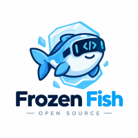

<div align="center">



# Frozen Fish

**Local-first AI orchestration. MCP-native. GPU-aware.**

`v0.9.4` · Apache-2.0 · Python ≥ 3.10 · zero hard runtime dependencies

</div>

---

Frozen Fish orchestrates the LLM backends you already run on your own hardware.
It routes every prompt with a live GPU-aware scoring router, exposes **12 sandboxed
MCP servers** to your agents, and serves context through a three-layer engine —
**CAG** (precomputed KV cache) → **CAR** (tool-partitioned vectors) → **RAG**
(retrieval fallback) — with a YAML workflow engine, RBAC, a PII-redacted audit
log, and an egress allowlist on every outbound call.

Your data never leaves the box.

## Quick start

```bash
# install
pip install frozen-fish        # or: pip install -e . from a checkout

# bring backends online (Frozen Fish discovers, never launches, these)
export OLLAMA_HOST=http://127.0.0.1:11434        # Ollama
export VLLM_HOST=http://127.0.0.1:8000          # vLLM
export LMSTUDIO_PORT=1234                        # LM Studio

# start the orchestrator (daemon + dashboard)
ff orchestrator start
# dashboard → http://127.0.0.1:8321

# watch it route
ff gpu list
ff gpu route --model llama3:8b
```

## The `ff` CLI

| Group | Commands |
|---|---|
| `ff orchestrator` | `start` · `stop` · `status` · `reload` |
| `ff mcp` | `register` · `list` · `inspect` · `call` · `unregister` |
| `ff workflow` | `deploy` · `list` · `logs` · `pause` · `resume` · `delete` |
| `ff context` | `cag build` · `cag invalidate` |
| `ff car` | `partition --by tool` |
| `ff rag` | `reindex --corpus <path>` |
| `ff gpu` | `list` · `route --model <name>` |
| `ff router` | `policy set` · `policy get` |
| `ff user` | `add <name> --role <admin\|operator\|viewer>` |
| `ff audit` | `tail --since 1h` · `export --format json` |
| `ff stats` | counters for routing, context, workflows |
| `ff dashboard` | `--metrics gpu,context,cost` |

## Architecture

```
request → RBAC gate → GPU-aware router → context engine (CAG → CAR → RAG)
                │              │                     │
                ▼              ▼                     ▼
          audit.db      backend registry      CAG KV (≤32k tok)
          (SQLite,      (Ollama · vLLM ·      CAR partitions
           PII-safe)     LM Studio ·           (by MCP tool)
                         llama.cpp ·           RAG (top-k 5,
                         Transformers,        MMR λ=0.7, HyDE)
                         OpenAI-compat)
                          ▲
                          │
        MCP registry — 12 servers, one sandbox
        (filesystem · sqlite · web_scraper · git · email · shell ·
         slack · vector_db · http_client · markdown + optional
         postgres / browser runtimes)

        scheduler (cron/interval/event) → workflow engine
        → 3× retry, 2s exponential backoff → dead-letter queue
```

Package layout (stdlib only): `frozenfish/{config,security,audit,mcp,gpu,
router,context,workflow,orchestrator,dashboard,cli}.py`.

## GPU-aware routing

```
score = 0.5·(1 − utilization) + 0.3·warm(model) + 0.2·(1 − queue/64)
        + 0.25·sticky(session)
```

- Policies: `gpu_aware` (default), `round_robin`, `least_queue` — `ff router policy set <p>`.
- Weights are config-tunable and must sum to 1.0. Unhealthy backends score −1.
- CUDA utilization is probed via `nvidia-smi`; other accelerators report 0.
- Discovery only: `OLLAMA_HOST` / `VLLM_HOST` / `LMSTUDIO_PORT` + config-declared
  endpoints. Frozen Fish never launches your servers.

## Context engine

| Layer | What it does | Config |
|---|---|---|
| **CAG** | Prefices with stable fingerprints → precomputed KV entries, ~85 ms TTFT warm | `cag.max_tokens: 32768` |
| **CAR** | Vector index partitioned by MCP tool boundary — no cross-tool bleed | `car.partition_by: tool` |
| **RAG** | top-k 5, threshold 0.35, MMR λ=0.7, HyDE expansion, RRF merge (k=60) | `rag.*` |

`ContextRouter.resolve()` walks CAG → CAR → RAG and returns
`{source, confidence, chunks}`.

## Security

- **RBAC**: `admin` (`*`), `operator` (workflow/gpu/mcp:call), `viewer` (read) — per-segment wildcards.
- **Audit**: SQLite, PII redaction (email, phone, SSN, API keys → `[REDACTED]`).
- **Egress**: hostname / `*.wildcard` / CIDR allowlist for every outbound HTTP call. **Empty allowlist = deny all.**
- **Sandbox**: tool calls run under `.ff/sandbox` with denied paths (`/etc`, `/usr`, `/boot`, `/var`), 1 MiB output cap, 30 s timeout.

## Configuration

One versioned YAML (`version: "0.9"`); defaults ship in-package.
`$FF_CONFIG` or `--config` overrides. PyYAML is optional — a built-in mini-parser
handles the schema. See [docs/config.md](docs/config.md) and
`examples/config.example.yaml`.

## Workflows

12 pipelines ship in `workflows/` (email summarize, repo triage, daily digest,
gpu watchdog, cag rebuild, code review, …). Triggers: `cron` (5-field),
`interval` (seconds), `event` (JSON drop-dir). Steps may reference prior results
with `{{steps.name.result}}`; failures retry 3× with 2 s exponential backoff,
then land in the dead-letter queue. See [docs/workflows.md](docs/workflows.md).

## Benchmarks (reference rig, design claims)

RTX 4090 / A100 80G / M2 Max, llama3:8b & Qwen2.5-14B, 2025-09 reference run:
**85 ms** CAG TTFT (A100), **+5.6** MuSiQue F1 vs flat RAG on multi-hop,
**3.1×** throughput vs naive round-robin under 8-way load. Your hardware will vary.

## Hardware

CUDA · ROCm · Metal · Vulkan · OpenVINO · CPU — via Ollama, vLLM, LM Studio,
llama.cpp, Transformers, and any OpenAI-compatible endpoint.

## Contributing

Read [CONTRIBUTING.md](CONTRIBUTING.md). Tests: `pip install -e ".[dev]" && pytest`.
Landing page: `site/index.html` (open directly in a browser).

## License

[Apache License 2.0](LICENSE).
